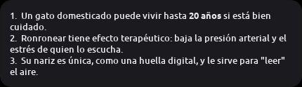

# opencode-pet

<p align="center">
  
  
  
</p>

Mascota de escritorio mínima para [opencode](https://opencode.ai). Una **mini
terminal con cara** (o un gato) vive en una esquina de la pantalla: haces clic,
escribes y el mensaje va a opencode. Si opencode pide permiso, sale una burbuja
con **Sí / No**; cuando termina, enseña la respuesta y, si quieres, la lee en
voz alta.

Gasta **~66 MB de RAM y 0 % de CPU en reposo** (medido en un i5-3210M con
XFCE). Sin WebKit, sin imágenes en la interfaz y sin animaciones caras: la
mascota son primitivas de Cairo. La cara cambia con el estado (cursor parpadeando, `> <` con barra de
progreso mientras trabaja, `^ ^` al terminar, ojos rojos si pide permiso o
falla).

Probado en **Linux/X11** con opencode 2.x. En Wayland el atajo global y algunas
posiciones de ventana pueden no funcionar; el resto (GTK3) sí.

## Características

- **Clic para hablar**: entrada flotante, sin abrir una terminal.
- **Permisos en la burbuja**: Sí / No cuando opencode pide confirmación.
- **Respuestas cortas**: usa un agente oculto (`pet-mascota`) de 2 frases.
- **Voz opcional**: micrófono → whisper.cpp → opencode → piper (rápido) o
  kokoro (más natural), con volumen, graves y nitidez ajustables.
- **Historial**: ↑ / ↓ en el campo de texto.
- **Copiar la última respuesta**, silenciar la voz y abrir una sesión nueva
  desde el menú del clic derecho.
- **Se oculta** si hay una ventana a pantalla completa.
- **Reconexión automática** si el servidor de opencode se cae.
- **Sin daemon propio**: el pet no abre puertos ni deja procesos de red
  propios; habla con un `opencode serve` local que arranca `start.sh`.

## Requisitos

| | |
|---|---|
| Sistema | Linux con X11 (probado en XFCE) |
| Python | 3.9 o superior |
| Interfaz | GTK3 + PyGObject + pycairo |
| Red | `curl` (lo usa `start.sh`) |
| opencode | CLI de opencode instalado y autenticado |
| Audio | `aplay` / `arecord` de `alsa-utils` (solo para la voz) |
| Audio EQ | `ffmpeg` (opcional, para volumen/graves/nitidez) |
| Atajo global | `python-xlib` (opcional, para `Ctrl+F`) |
| Voz | `git`, `pip`, `cmake` y un compilador C++ (los usa `voice-setup.sh`) |

Instalación de dependencias habituales:

```bash
# Debian / Ubuntu
sudo apt install python3-gi python3-gi-cairo gir1.2-gtk-3.0 \
                 python3-cairo alsa-utils curl ffmpeg

# Arch
sudo pacman -S python-gobject python-cairo gtk3 alsa-utils curl ffmpeg

# Fedora
sudo dnf install python3-gobject python3-cairo gtk3 alsa-utils curl ffmpeg
```

`python-xlib` se instala aparte si quieres el atajo global:

```bash
pip3 install --user python-xlib
```

## Instalación

```bash
git clone https://github.com/AngelUciDev/opencode-pet.git
cd opencode-pet
./install.sh          # lanzador del menú + agente del pet
./start.sh            # primera ejecución
```

`install.sh` no instala paquetes ni descarga modelos: comprueba dependencias,
crea `~/.local/share/applications/opencode-pet.desktop` y copia el agente
`agents/pet-mascota.md` a `~/.config/opencode/agents/` (solo si no existe).

Si quieres que arranque al iniciar sesión:

```bash
./install.sh --autostart
```

`start.sh` reutiliza un `opencode serve` propio si ya está corriendo o levanta
uno en `127.0.0.1:4599`. La contraseña se guarda en
`~/.config/opencode-pet/config.json` con permisos `600`.

```bash
./start.sh                    # sesión en el directorio actual
DIR=~/proyecto ./start.sh     # o en otro directorio
PORT=4600 ./start.sh          # otro puerto
```

Para cambiar el modelo o el agente: **clic derecho sobre la mascota →
Configuración…**. Los agentes y modelos se piden al servidor de opencode.

## Uso

| Acción | Qué hace |
|---|---|
| **clic** | Abre el campo de texto (si solo se ve una respuesta, pasa a escribir) |
| **clic otra vez, escribiendo** | Cierra la burbuja |
| **arrastrar** | Mueve la mascota; la posición se recuerda |
| **Enter** | Envía |
| **↑ / ↓** | Recupera mensajes anteriores |
| **Esc** | Cierra la burbuja |
| **🎤 / Ctrl+Shift+F** | Empieza o para la grabación (si la voz está instalada) |
| **clic derecho** | Configuración, copiar última respuesta, silencio, nueva sesión, cerrar |

El clic y el arrastre comparten el botón izquierdo: si el puntero se mueve más
de 4 px es arrastre; si no, es clic.

## Voz (opcional)

La voz tiene dos partes independientes: **entrada** (micrófono) y **salida**
(TTS). Ambas se instalan con `voice-setup.sh` para piper, o con
`kokoro-setup.sh` si prefieres kokoro.

```bash
./voice-setup.sh       # whisper.cpp + piper + voz es_MX-claude-high (~450 MB)
./kokoro-setup.sh      # kokoro + onnxruntime (~150 MB, más lento)
```

`voice-setup.sh` compila whisper.cpp y descarga el modelo `base` multilingüe,
el binario de piper y una voz en español. Todo queda en `voice/`, que está en
`.gitignore` (los modelos no se suben al repositorio).

Para usar otra voz de piper:

```bash
PIPER_VOICE_NAME=es_MX-ald-medium ./voice-setup.sh
```

y pon su ruta en el config:

```json
"voice": { "tts_voice": "/ruta/a/opencode-pet/voice/voices/es_MX-ald-medium.onnx" }
```

Puedes descargar más voces de
[rhasspy/piper-voices](https://huggingface.co/rhasspy/piper-voices). Cada voz
tiene su propia licencia; revisa su ficha antes de redistribuirla.

### Motores: piper (fluido) o kokoro (natural)

| | **piper** (por defecto) | **kokoro** |
|---|---|---|
| Naturalidad | más robótica | alta |
| Espera hasta oír algo | ~2 s | 4–8 s (troceado) / 14–18 s (lote) |
| Pausas dentro de la respuesta | **ninguna** | 2–3 s entre trozos |
| Coste de síntesis | ~0,2× el audio | ~1,8× el audio |
| RAM mientras habla | ~40 MB | ~320 MB |
| Instalación | `voice-setup.sh` | `kokoro-setup.sh` |

En un CPU de 2 núcleos kokoro sintetiza **más lento que el tiempo real**. Por
eso hay dos modos:

- `kokoro_batch: true` (por defecto): sintetiza toda la respuesta y reproduce
  un solo WAV. No hay pausas, pero tarda en empezar.
- `kokoro_batch: false`: empieza antes, pero deja pausas entre trozos.

Cambia de motor en **Configuración… → Motor de voz** o con
`"voice": {"engine": "piper"}`. El botón **▶ oír** genera una frase de ejemplo
con el motor y la voz elegidos.

### Ajustar el audio

Solo afecta a la voz de la mascota: **no cambia el volumen del sistema** ni el
de otras aplicaciones. En **Configuración… → Audio**:

| Deslizador | Clave | Rango | Efecto |
|---|---|---|---|
| **Volumen** | `audio_gain` | −15…+15 dB | Sube o baja la ganancia |
| **Graves** | `audio_bass` | −12…+12 dB | Refuerza o quita bajos (~120 Hz) |
| **Nitidez** | `audio_treble` | −12…+12 dB | Realza agudos (~3,5 kHz) |

Se aplican con `ffmpeg` (`volume`, `bass`, `treble`) y un limitador para que la
ganancia no sature. Cuesta ~0,13 s por WAV. Si los tres están a 0 no se llama a
ffmpeg. **▶ probar** escucha los valores actuales sin guardar.

## Configuración

El archivo se crea solo en `~/.config/opencode-pet/config.json`. Ejemplo
completo en [`config.example.json`](config.example.json):

```json
{
  "server": "http://127.0.0.1:4599",
  "username": "opencode",
  "password": "...",
  "directory": "/home/tu-usuario",
  "reuse_session": false,
  "model": { "providerID": "opencode", "id": "deepseek-v4.1-flash-free" },
  "agent": "pet-mascota",
  "mascot": "terminal",
  "reply_timeout": 15,
  "hide_fullscreen": true,
  "hotkey": "ctrl+f",
  "voice": {
    "enabled": true,
    "muted": false,
    "reply": "voz",
    "max_seconds": 20,
    "language": "es",
    "engine": "piper",
    "hide_text": false,
    "audio_gain": 0,
    "audio_bass": 0,
    "audio_treble": 0
  }
}
```

| Clave | Para qué |
|---|---|
| `mascot` | `"terminal"` (por defecto) o `"gato"` |
| `reply_timeout` | Segundos que una respuesta se queda visible (`0` = nunca) |
| `hide_fullscreen` | `true` oculta la mascota si hay una ventana a pantalla completa |
| `hotkey` | Atajo global (`""` lo desactiva) |
| `voice.reply` | `"voz"` (solo si hablaste), `"siempre"` o `"nunca"` |
| `voice.hide_text` | `true` = si la respuesta suena, no se muestra también |
| `reuse_session` | `true` = continúa la conversación anterior al arrancar |

`start.sh` sobrescribe `server` y `password` en cada arranque: `opencode serve`
genera una contraseña nueva. No edites esos dos campos a mano.

### El agente `pet-mascota`

La burbuja es pequeña, así que el pet usa un agente oculto con respuestas de
2 frases / ~35 palabras y sin anuncios del tipo «voy a…».

El agente incluido es **de solo consulta**: puede leer archivos, pero no
editar ni ejecutar comandos. Si quieres que trabaje, edita
`~/.config/opencode/agents/pet-mascota.md` y cambia los `deny` por `allow` (o
borra el bloque `permissions`). Ten en cuenta que entonces podrá modificar
archivos y ejecutar shell; el pet te pedirá permiso solo para lo que opencode
marque como sensible.

Si no quieres el agente, pon `"agent": ""` en el config y el pet usará el
agente por defecto de opencode.

## Cómo funciona

<details>
<summary>API de opencode, sesiones y permisos</summary>

Usa el API HTTP de opencode, todo contra `127.0.0.1`:

| Para | Endpoint |
|---|---|
| enviar | `POST /api/session/{id}/prompt` |
| ¿terminó? | `GET /api/session/{id}` → `time.idle` + `outcome` |
| respuesta | `GET /api/session/{id}/message` |
| permiso | `GET /api/session/{id}/permission` |
| responder | `POST /api/session/{id}/permission/{rid}/reply` |

No usa el stream SSE: sus eventos llegan con `properties: {}` vacío y la propia
API lo marca como *volatile by contract*. Sondear los endpoints REST cada 1,5 s
es más fiable y cuesta lo mismo.

Tres detalles que no son intuitivos:

1. `/api/session/{id}/message` devuelve los mensajes **del más nuevo al más
   viejo**. Hay que recorrerla al revés.
2. La lista intercala entradas sintéticas (`idle`, `model-switched`); se usa el
   **id** de cada mensaje para saber qué es nuevo, no el índice.
3. `POST /prompt` con la sesión ocupada devuelve 200 con
   `"delivery":"steer"`: se inyecta en el turno que ya corre. Por eso el pet
   tiene **sesión propia**, guardada en el config.

</details>

<details>
<summary>Interfaz GTK y X11</summary>

Las dos ventanas son `TOPLEVEL` con `_NET_WM_WINDOW_TYPE_UTILITY`, **no**
`POPUP`. En X11 una ventana `POPUP` es *override-redirect* y no recibe el foco
del teclado por mucho que se le ponga `set_accept_focus(True)`. El foco se
concede por tres vías (`map-event`, `idle` y un `timeout` de 120 ms) porque
hacerlo solo con `idle_add` era una carrera.

El atajo global usa `XGrabKey` mediante `python-xlib`; al ser global, `Ctrl+F`
deja de llegar a las demás aplicaciones. Se desactiva con `"hotkey": ""`.

</details>

## Problemas comunes

- **«no veo el server»** → mira `~/.config/opencode-pet/serve.log` y
  `~/.config/opencode-pet/pet.log`.
- **El pet se queda en ámbar** → el servidor responde pero algo falla; el texto
  del error sale en la burbuja.
- **401 tras reiniciar** → `opencode serve` cambió la contraseña. `start.sh` la
  actualiza sola; si lanzaste el server a mano, reinícialo con `./start.sh`.
- **«Model ... has been deprecated»** → elige otro modelo en Configuración o
  cambia `model.id` en el config.
- **No hay sonido** → comprueba `aplay` y vuelve a ejecutar `./voice-setup.sh`.
  Si usas `voice.hide_text`, la respuesta solo suena; revisa el volumen del
  sistema.
- **`Ctrl+F` no funciona** → instala `python-xlib` y reinicia; en Wayland el
  grab global puede no estar disponible.
- **No aparece en el menú** → vuelve a ejecutar `./install.sh` y comprueba que
  `~/.local/share/applications/opencode-pet.desktop` apunta a tu ruta.

## Desarrollo

```bash
python3 -m py_compile pet.py voice/kokoro/tts.py voice/kokoro/daemon.py
./make-icon.py 256 capturas/mascota.png terminal
./make-icon.py 128 opencode-pet.png gato
```

`make-icon.py` dibuja el icono con el mismo código que la mascota, así que no
hay dos versiones del dibujo que mantener.

Hay pruebas rápidas sin servidor ni pantalla:

```bash
python3 -m unittest discover -s tests -v
```

Las pruebas de interfaz están en [`tests/manual/`](tests/manual/) y no forman
parte de la suite: necesitan X11, `xdotool` y un servidor de opencode real.

## Licencia y créditos

Código bajo licencia [MIT](LICENSE). Los modelos y voces **no** están en el
repositorio y cada uno tiene su propia licencia:

- [whisper.cpp](https://github.com/ggml-org/whisper.cpp) y sus modelos.
- [piper](https://github.com/rhasspy/piper) y las voces de
  [rhasspy/piper-voices](https://huggingface.co/rhasspy/piper-voices).
- [Kokoro-82M](https://huggingface.co/onnx-community/Kokoro-82M-v1.0-ONNX) y
  [kokoro-onnx](https://github.com/thewh1teagle/kokoro-onnx).

Hecho para usar [opencode](https://opencode.ai). No está afiliado al proyecto
opencode.
